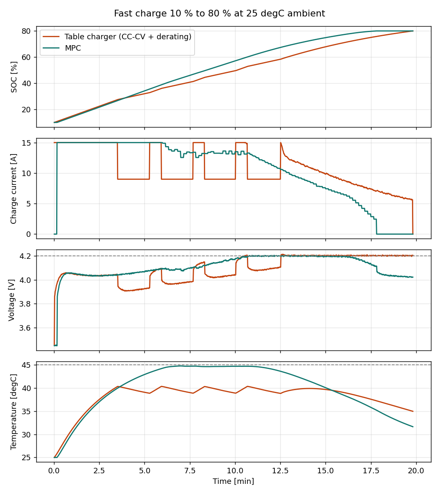

# Battery Brain

State estimation, learned model correction and predictive fast charging for a
lithium-ion cell, with a live interactive demo that runs the real Python code
in the browser.



## What it does

A battery management system has two hard jobs: knowing how full the cell is
(it cannot be measured directly) and charging it as fast as possible without
damaging it. This project builds both, from scratch, in NumPy.

| Piece | Method | File |
|---|---|---|
| State of charge estimation | Extended Kalman filter on an equivalent-circuit model | `batterybrain/ekf.py` |
| Model correction | Neural network (hand-written backprop and Adam) that learns the circuit model's voltage error; the EKF uses it inside its measurement equation | `batterybrain/residual_net.py` |
| Fast charging | Nonlinear MPC by sequential quadratic programming, with soft voltage and temperature constraints | `batterybrain/mpc.py` |
| Optimiser | Mehrotra predictor-corrector primal-dual interior-point QP solver | `batterybrain/qp.py` |
| Offset-free control | Kalman disturbance observer for unmodelled heat, plus online resistance adaptation | `batterybrain/mpc.py`, `batterybrain/sim.py` |
| Plant | 2-RC cell with hysteresis, temperature- and SOC-dependent resistance, thermal model, ageing | `batterybrain/cell.py` |

The algorithms are designed against a deliberately simpler model than the
plant they run on (one RC pair, datasheet resistances, no hysteresis). That
mismatch is what the Kalman filter has to survive and what the network learns.

## Results (simulation)

Full tables in [docs/results.md](docs/results.md), regenerated by
`python scripts/evaluate.py`.

**Estimation.** Mean RMS state-of-charge error across two load profiles and
four ambient temperatures (0 to 40 degC), after every estimator is started
20 % wrong:

| Coulomb counting | EKF | EKF + neural network |
|---|---|---|
| 18.4 % | 2.71 % | 0.13 % |

**Fast charging, 10 % to 80 %,** limits 15 A, 4.2 V, 45 degC, against a
conventional CC-CV charger with a stepped temperature derating table:

| Ambient | Table charger | MPC | Difference |
|---|---|---|---|
| 10 degC | 20:53 | 21:41 | MPC 4 % slower |
| 25 degC | 19:49 | 17:49 | MPC 10 % faster |
| 35 degC | 25:09 | 22:21 | MPC 11 % faster |

MPC peak temperature stays at 44.8 degC in the thermally limited cases.

### Read these numbers honestly

- Everything is simulated. There is no real cell data in this project.
- The network is trained on data from the same simulator it is tested on
  (different seeds and temperatures, same physics). Its 0.13 % is an upper
  bound on what the method can do, not a prediction for a real cell.
- The plain EKF baseline uses fixed datasheet parameters with a simple
  temperature correction. A production BMS with full lookup tables would sit
  somewhere between the two.
- At 10 degC charging is voltage-limited, not temperature-limited, so
  prediction has nothing to exploit and the MPC's safety margins make it
  slightly slower. Both chargers overshoot 4.2 V by 11 to 15 mV there.
- The table charger's thresholds are typical, not tuned to this cell. A
  better-tuned table would narrow the gap.

## Run it

```bash
pip install numpy pytest matplotlib
```

```bash
python -m pytest
```

```bash
python scripts/train_residual.py
```

```bash
python scripts/evaluate.py
```

Interactive demo: serve the repository, then open
`http://localhost:8765/web/` in a browser.

```bash
python -m http.server 8765
```

The demo loads Pyodide (CPython compiled to WebAssembly) from a CDN, copies
this package into it and calls the same `EstimationSession` and `ChargeRace`
classes the tests use. There is no JavaScript re-implementation of the
algorithms and no server-side computation, so the page can be hosted as-is on
GitHub Pages.

## Things to try in the demo

1. **Scramble the estimates.** Coulomb counting never recovers; the filters do.
2. **Drop ambient to 0 degC.** The plain EKF drifts because its resistance
   model is now wrong; the hybrid one holds.
3. **Add a 200 mA current sensor offset.** Coulomb counting integrates the
   error forever; voltage feedback bounds it.
4. **Age the cell by 20 %.** Both filters get worse, including the network,
   which never saw an aged cell. This is the limit of a learned model.
5. **Race at 35 degC, then at 10 degC.** The MPC's advantage appears only when
   the temperature limit is the binding one.

## Layout

```
batterybrain/   the package (plant, EKF, network, QP solver, MPC, sessions)
scripts/        training and benchmark scripts
tests/          11 tests: KKT conditions, gradient checks, convergence, limits
web/            the browser demo (HTML, CSS, plain JS, Pyodide worker)
docs/           theory notes, results, plots
```

## Theory

[docs/theory.md](docs/theory.md) derives each piece and lists what I would do
next.
